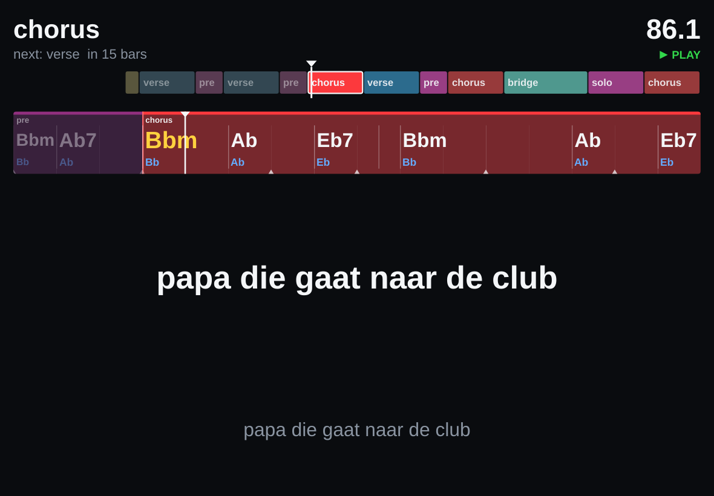
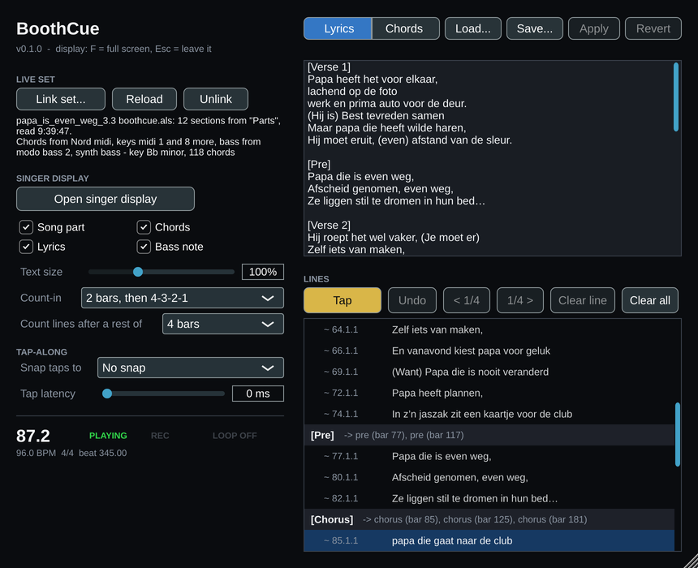
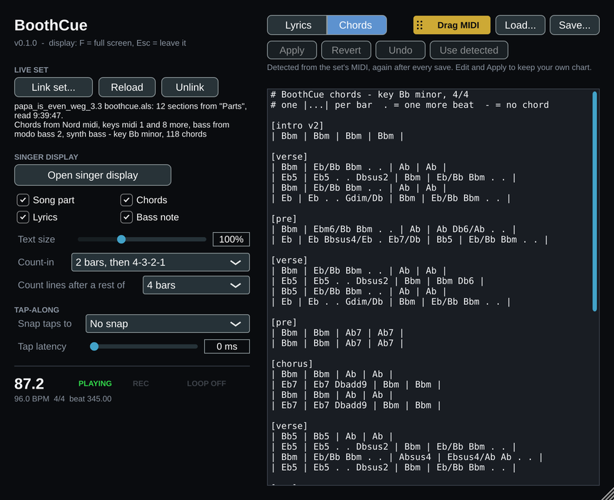

# BoothCue

**The lyrics, the chords and where you are, on the singer's screen.** BoothCue
is a plugin for tracking in Ableton Live (VST3 + Standalone, JUCE 8, macOS
first). It reads the song structure and the MIDI from your Live set, and shows
the singer, on a second monitor or an iPad, the part you're in, the lyric line
to sing, the chords coming up and a count-in to the next entry. With the lyrics
switched off, the same window works for a keys or guitar player.



## What it does

- **Follows your Live set.** Link the `.als` once. BoothCue reads it again
  after every save: the song parts from a MIDI track named **`parts`** (each
  clip is a part, its name is the part's name, its colour is the part's colour
  on the display), and the notes of every MIDI track for the chords. BoothCue
  only reads the set; it never writes to it.
- **Three zoom levels on one screen.**
  - The whole song as coloured parts, with the playhead.
  - A ticker of about 16 bars around the playhead with the chords at their
    changes: the current chord in yellow, the bass note under each chord, marks
    where lyric lines start, and the loop.
  - Now: the line being sung, large (ordinary lines stay on one line on a 10"
    iPad), the next line in grey, and the count-in to the next entry
    ("2 bars", "1 bar", then a big 4-3-2-1).
- **Toggles** for song part, lyrics, chords and bass note, and a text size.
- **Chords detected from the set's MIDI.** BoothCue works out which tracks
  carry chords, which one is the bass and which ones are melodies (from the
  track names and the notes). It filters out grace notes, runs, passing notes
  and suspensions, leans on the bass for the root, and smooths the result so a
  chord doesn't flicker. Notes below MIDI 33 (A0 in Live's note names), such
  as sound selectors and keyswitches, are ignored.
- **Lyrics pasted as they are.** Paste the text from your lyrics document.
  Section headers with or without brackets, in English or Dutch
  (`Refrein`, `Brug`, `Couplet`, `Pre`), `x 2`, a chorus that is only named
  again, chord-chart lines and a title line are all understood.
- **Timing by tapping along.** Without timing, the lines are spread over their
  part on the bar grid. Play the song and tap on each line's first word to
  pin it; nudge, clear or undo where needed.
- **Its own chords and lyrics, as text.** Edit the chords as a chord chart,
  save and load the chart and the timed lyrics as text files, and drag the
  chords into Live as a MIDI clip to use as a chord track.
- **Saved with the set**: the lyrics and their timings, the chords, every
  setting, and where the singer display was on screen.

## Installing on a Mac

Build it (below), or take a release folder with `BoothCue.vst3`,
`BoothCue.app` and `install.command`. Double-click `install.command` (the
first time, right-click it and choose Open). It copies the VST3 to
`~/Library/Audio/Plug-Ins/VST3` and the app to Applications, and removes the
quarantine flag, since the builds are not notarised by Apple. Then rescan
plug-ins in Live (Settings > Plug-Ins).

## Using it in Live

1. **Make a `parts` track.** Add a MIDI track named `parts` with an empty
   clip in the arrangement for every part of the song: name each clip after
   the part (`intro`, `verse`, `pre`, `chorus`, `bridge`, `outro`, ...) and
   give it a colour. If there is no track called `parts`, BoothCue uses the
   second track and says so.
2. **Add BoothCue** to the master track (or any track that always plays). It
   passes the audio through untouched; it only needs the playhead.
3. **Link the set**: *Link set...* and pick the `.als` (or drop it on the
   plugin window). Save the set in Live and BoothCue picks up the change
   within a second or two.
4. **Paste the lyrics** in the Lyrics tab (or *Load...* a `.txt`) and press
   *Apply*. Each block links to the parts with the same name; the line list
   below shows where every block is sung and what didn't link.
5. **Open the singer display** and move it to the singer's screen. Press
   **F** (or double-click) for full screen, **Esc** to leave it. For an iPad,
   use it as a second display (Sidecar, or a display app) and put the window
   there.
6. **Time the lyrics**: start playback, click the first line in the list and
   press **Tap** (or **T** / space in the singer display) on the first word of
   each line. The tap lands on the playhead at that moment, minus the tap
   latency and snapped to the grid you chose. Backspace in the display undoes
   the last tap.
7. **Phones for the band** (optional): *Phones...* shows a QR code for the
   songbook page of the [Bovenburen manager](https://github.com/joris-klingen/bovenburen_manager)
   running on this Mac with phone access (`--lan`). Scanning it on the same
   Wi-Fi opens the lyrics and chords; the phone is remembered after that.
   The QR encoder is BoothCue's own (`Source/QrCode.{h,cpp}`, plain C++).



### Lyrics text

```text
Papa die gaat naar de club        <- a title line (followed by a blank line): skipped

verse 1                           <- a header: also [Verse 1], "Refrein:", "Brug: first line"
Papa heeft het voor elkaar,
(Hij is)                          <- a short pickup in parentheses joins the next line
Best tevreden samen

chorus
Zet uw winkelwagen aan de kant! x 2   <- sung twice
@13.2.3 Hold on, hold on          <- a fixed start (bar.beat.16th), as Save writes them

Refrein                           <- a header on its own: "the chorus again"
# a comment
```

A block is sung in every part with its name (`[Chorus]` in every chorus;
`Refrein` = chorus, `Brug` = bridge, `Couplet` = verse, `Pre` = pre-chorus).
`[Verse 1]` and `[Verse 2]` go to the first and second verse. Editing the
text keeps the timing of every line you didn't change. *Save...* writes the
lyrics with their timings; *Load...* reads them back.

### Chords



The Chords tab shows the chords as a chart, one block per part:

```text
[chorus]
| Bbm | Bbm | Ab | Ab |
| Eb7 | Eb7 Dbadd9 | Bbm | Bbm |
```

One `|...|` per bar; chords in a bar share it evenly, `.` gives the chord
before it one more beat, `-` is no chord, an empty bar means the chord goes
on, `%` repeats the bar, `||: ... :||` and `x2` repeat. A line like
`Verse/Chorus: ||: Am | | | Dm E7 :||` (as found in lyric sheets) fills every
part of those kinds.

As long as you haven't edited them, the chords follow detection after every
save. *Apply* (or *Load...*) keeps your chart from then on; *Use detected* goes
back. *Undo* takes back the last change.

**Drag MIDI** drags the chords out as a MIDI file: drop it on a MIDI track at
bar 1 for a chord track (a voicing around middle C plus the bass note, the
chord names in the clip). Clicking it saves the `.mid` instead. Dropping a
`.mid` on the plugin window reads chords from it: by the chord names if it
has them, else detected from its notes.

### The song folder (the band's songbook)

*Link song...* (or dropping a folder on the plugin window) links the song's
folder in the songbook kept by
[bovenburen_manager](https://github.com/joris-klingen/bovenburen_manager):

- `lyrics.txt` and `chords.txt` in it are shown, and followed when they change
  (within a second or two): edit the song on a phone and the singer display has
  it. BoothCue never writes these two files; the songbook is their master.
- The starts you tap are written next to them as `timings.txt` (the timed
  lyrics, as *Save...* writes them). When the text changes, every unchanged line
  keeps its start; a new BoothCue on another set of the same song takes the
  starts from that file.
- A chart from the folder counts as edited chords: detection no longer replaces
  it. Without a `chords.txt` the detected chords stay.

The link is saved with the set. *Unlink song* stops following; what is shown stays.

### Settings

| Setting | Options |
|---------|---------|
| Show | Song part · Lyrics · Chords · Bass note |
| Text size | 50 - 200 % |
| Count-in | Off · Last bar only (4-3-2-1) · 1, 2 or 4 bars, then 4-3-2-1 |
| Count lines after a rest of | 1 · 2 · 4 · 8 bars (a line after such a rest is counted in) |
| Snap taps to | No snap · 16th notes · 8th notes |
| Tap latency | 0 - 200 ms, taken off every tap |

## Building

You need CMake 3.22+ and Xcode (or the Command Line Tools). CMake fetches
JUCE 8.0.15 through `FetchContent`.

```sh
cmake -S . -B build -G Xcode
cmake --build build --config Release
ctest --test-dir build -C Release
```

The VST3 is built at `build/BoothCue_artefacts/Release/VST3/BoothCue.vst3`
and the app at `build/BoothCue_artefacts/Release/Standalone/BoothCue.app`.
Add `-DBOOTHCUE_COPY_PLUGIN=ON` to the configure step to also copy the VST3
into `~/Library/Audio/Plug-Ins/VST3`.

It also builds on Linux (the JUCE dev packages and zlib), which is what CI
runs: all tests, with the editor and display ones under Xvfb, and pluginval
at strictness 10. `-DBOOTHCUE_BUILD_PLUGIN=OFF` builds only the plain C++
core and its checks, without JUCE's GUI dependencies.

## Tools for real sets

```sh
als-check --chords <set.als> [bar beats] [lyrics.txt]   # tracks and roles, chords per bar, lyric linking
als-check --chart <set.als>                             # the detected chords as a chart
prompter-render --set <set.als> [lyrics.txt] <out.png> [beat ...]   # the display at iPad size
prompter-render --midi <set.als> <out.mid>              # the chords as Drag MIDI gives them
```

## Under the hood

- `Source/AlsParser`: a streaming gzip + XML reader for `.als` files: the parts
  and their colours, and the notes of every MIDI track (clip loops, start and
  end markers, deactivated clips and notes). Plain C++ and zlib.
- `Source/Chords` and `Source/SetChords`: the chord detector, plain C++.
- `Source/Song`, `Source/LyricImport`, `Source/ChordChart`, `Source/Prompter`:
  the song model, the lyric and chord-chart text formats, and what the display
  shows at a position. Plain C++, no JUCE, no clock.
- `Source/PrompterPainter`, `PrompterView`, `DisplayWindow`: the singer display.
- `Source/SetWatcher`: re-reads the linked set on a background thread.
- `Source/PluginProcessor`, `PluginEditor`, `ChordMidi`: the plugin.
- `tools/`: console checks that run as CTests (`als-parser`, `chord-detect`,
  `song-logic`, `prompter-render`, `set-watcher`, `plugin-smoke`).

[CLAUDE.md](CLAUDE.md) has the conventions, [STATUS.md](STATUS.md) the state
and changelog, [TODO.md](TODO.md) the plan and backlog.

## Family

BoothCue uses the plugin layout of
[flashroll](https://github.com/joris-klingen/flashroll) and
[hitnotedmx](https://github.com/joris-klingen/hitnotedmx), the plugin identity
and CI of [harmeq](https://github.com/joris-klingen/harmeq), and reads `.als`
files the way [bbb_code](https://github.com/joris-klingen/bbb_code) does.
